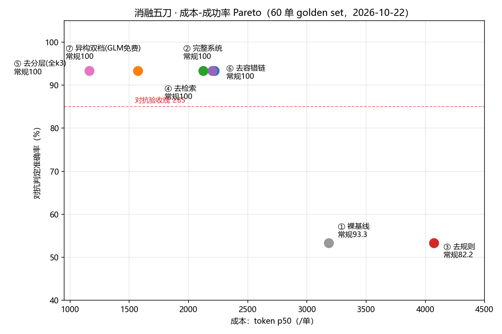

# 消融④⑤⑥ + 成本 Pareto 收官报告（2026-10-22）

> 与③同纪律：每刀独立图文件（`graph_abl4/5/6.py`），通用 runner `run_eval_abl.py`（--mod 指定图模块，
> 结果各自独立 jsonl，补记 policy_citations/reason），通用判分器 `score_ablation.py`。
> 原 `graph.py`/`run_eval.py` 始终一字未动。同 golden set（60 单）、同 oracle HITL、同 b组顺序时序纪律。

## 一、四刀总表（实测，③单列报告见 report_abl3_no_rules.md）

| 配置 | 常规(45) | 对抗(15) | 误转率 | 引用贯通 | token p50 | 延迟 p50 | 单点结论 |
|---|---|---|---|---|---|---|---|
| ① 裸基线 | 93.3 | 53.3 | — | — | 3184 | 39.8s | 基准 |
| ② 完整系统 | 100 | 93.3 | 0 | 100% | 2218 | 12.9s | 验收线全过 |
| ③ 去规则 | 82.2 | 53.3 | 16.7%✗ | — | 4073 | 57.3s | **规则层是命中率的命**（+40pp 对抗） |
| ④ 去检索 | 100 | 93.3 | 0 | **0%** | 2125 | 12.9s | **检索的价值纯是可审计性**（判定零变化） |
| ⑤ 去分层(全k3) | 100 | 93.3 | 0 | 100% | **1572** | 14.7s | **token 口径最省，双档省钱叙事被推翻** |
| ⑥ 去容错链 | 100 | 93.3 | 0 | 100% | 2201 | 13.0s | **容错链零触发——没被压测，不是没价值** |

## 二、④去检索：最"平静"的一刀，和③互为镜像

判定指标与②**逐项全等**（含 B01 原理性误判都复刻），token/延迟差在噪声内——赛前判断兑现：
检索（cite/search）从不参与 verdict，它唯一的产出是给确定性结论配"依据 v1.0 x.y「原文」"的版本化指针。
摘掉后引用贯通率 100%→0：34 张判否/转人工单全部退回裸条款号。

与③合看是一对完整论据：**检索喂给 LLM 当判断依据（③）= 不可靠（检索漏 2 单致命）；
检索给确定性结论配审计指针（②）= 零成本、零风险、纯增益**。这就是 mini RAG 在系统里的正当岗位。

## 三、⑤去分层：预测最大的落空，双档省钱叙事被实测推翻

赛前预测"成本回到 ~100% of ①"，实测 token p50 **1572 = ②的 71%、①的 49%**——全 k3 反而全场最省。
字段对账：k2.6 与 k3 的 OCR 字段准确率同为 **360/360 = 100%**，判定逐项全等。
机制推断：k2.6 的"轻推理"在完整 OCR schema 上并不轻（②冒烟单均 1698 token），
k3 对简单提取任务推理更紧凑；且 k3 OCR 高置信几乎不触发 escalation 二次调用。

**caveat（写死在报告里）**：token 数 ≠ 账单。k3 单价若显著高于 k2.6，按价重算结论可能反转；
双档架构在"价差真实存在"或"k3 配额受限"时仍有工程意义。本数据集上它的准确率收益为零。

## 四、⑥去容错链：测不出贡献的一刀，观察项坐实

判定与②全等，token p50 2201 vs ② 2218（差 17 token ≈ ②全程几乎没触发 escalation）。
**T2 容错链在现有 degrade 强度下零触发**：现有模糊单对 k2.6/k3 都无挑战（字段 100%），
v0.5 以来的观察项坐实。纪律不变：不动 golden set；容错链机制正确性由 `test_escalation.py`
注入单测兜底（k3 真把模糊件 invoice_code 从 0000 重抽为真值）。若将来要定量它的价值，
唯一正当路径是按升压纪律重生成更强 degrade 的模糊分层，另立评估集。

## 五、Pareto 结论与四刀总叙事

成功率并列的 {②④⑤⑥} 中，**⑤(token 口径)是 Pareto 最优点**；②的价值证明不在成本而在结构——

1. 规则层（③的反面）：对抗 +40pp、常规 +17.8pp、成本 −45%、延迟 −77%——**命中率的第一支柱，0 token**；
2. 检索（④的反面）：判定零贡献、可审计性全贡献——**引用指针是合规系统的交付物，不是副产品**；
3. 分层（⑤的反面）：本数据集 token 口径无收益，保留理由是单价差与配额的工程对冲——**叙事从"省钱"改为"对冲"**；
4. 容错链（⑥的反面）：未被压测，机制有单测背书——**它是保险费，不是利润来源**。

一句话总结：四刀下来，真正扛命中率的是 0 token 的规则层和工具证据链；LLM 的正当岗位是
"把图读成字段"和"在权限/能力边界前停下来"，而不是拿着制度原文做边界判断（③实测它不敢也不会）。
